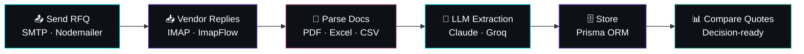

<!-- ═══════════════════════ HEADER ═══════════════════════ -->
<div align="center">


<a href="https://github.com/anuragkaushik00">
  
</a>

<br/>


<br/><br/>

<a href="https://www.linkedin.com/in/anurag-kaushik-608a92249"></a>
<a href="https://github.com/anuragkaushik00"></a>
<a href="mailto:theanuragkaushik@gmail.com"></a>
<a href="https://instagram.com/_theanuragkaushik_?igshid=NzZlODBkYWE4Ng=="></a>
<a href="https://rotaractgalgotias.org"></a>

</div>

<br/>

<!-- ═══════════════════════ ABOUT (CODE VIBE) ═══════════════════════ -->
<div align="center">
  
</div>

```typescript
// 👨‍💻 about.ts

const anurag: Engineer = {
  name: "Anurag Kaushik",
  role: ["Automation Engineer", "Data Analyst", "AI & Automation Builder"],
  company: "SpiceJet ✈️  (Procurement & Inventory Analytics)",
  location: "Gurugram, Haryana, India 🇮🇳",
  education: "B.Tech, Electronics & Communication Engineering — GCET",

  currentlyBuilding: "RFQ Automation Platform (Next.js + TypeScript + Claude & Groq APIs)",
  currentlyLearning: ["LangGraph", "Agentic AI", "MCP with Python", "Docker"],

  superpower: "Turning messy procurement & inventory data into dashboards, automated reports & decisions",
  philosophy: "Ship tools people actually use.",

  funFact: "I also build a bionic arm that reads muscle signals 🦾",

  lookingFor: ["AI automation", "Full-stack + LLM projects", "Data-driven problem solving"],
};
```

<br/>

<!-- ═══════════════════════ TECH STACK ═══════════════════════ -->
<div align="center">
  

<br/>

**🧠 Languages**<br/>


**🌐 Full-Stack & Tools**<br/>


**🤖 AI & Automation**<br/>


**📊 Data & BI**<br/>


**🌱 Currently Learning**<br/>


</div>

<br/>

<!-- ═══════════════════════ FEATURED PROJECTS ═══════════════════════ -->
<div align="center">
  
</div>

<br/>

<div align="center">

### 🤖 RFQ Automation Platform &nbsp;`Current Project`

<a href="https://github.com/anuragkaushik00/RFQ_Automation">
  
</a>
<a href="https://github.com/anuragkaushik00/RFQ_Automation-">
  
</a>

</div>

> A full-stack web app that automates the **Request-for-Quotation** workflow, from sending RFQs to vendors to collecting and comparing their quotations.



<table align="center">
<tr>
<td width="50%" valign="top">

**⚙️ What it does**
- 🧠 Extracts quotation data from vendor **PDFs, spreadsheets & emails** using LLM APIs
- 📬 **IMAP inbox ingestion** + **SMTP dispatch** for vendor communication
- 🗄️ Data modelling with **Prisma ORM**
- 🔐 Secure auth via **NextAuth**

</td>
<td width="50%" valign="top">

**🧰 Built with**
<br/>

<br/><br/>
`pdf-parse` · `ExcelJS` · `csv-parse` · `ImapFlow` · `Mailparser` · `Nodemailer` · `NextAuth`

</td>
</tr>
</table>

<br/>

<div align="center">

### 💻 APSITE-TECHNOLOGIES &nbsp;`C++`

<a href="https://github.com/anuragkaushik00/APSITE-TECHNOLOGIES">
  
</a>

*A set of 5 tasks provided by Apsite Technologies, built in C++.*

</div>

<br/>

<table align="center">
<tr>
<td width="50%" valign="top" align="center">

### 🦾 Bionic Arm
`Oct 2024 – Present`


An **Arduino & EMG-based prosthetic control** prototype. It reads EMG sensor signals to drive servo motors for intuitive limb control, using embedded systems and signal processing with healthcare applications in mind.

</td>
<td width="50%" valign="top" align="center">

### 🌐 Rotaract Club Website
`Jul 2023 – Nov 2024`


Led development and optimization of the **About, Teams & Events** sections, using data-driven insights to improve user engagement.

<a href="https://rotaractgalgotias.org"></a>

</td>
</tr>
</table>

<br/>

<!-- ═══════════════════════ EXPERIENCE ═══════════════════════ -->
<div align="center">
  
</div>

<br/>

<details open>
<summary><b>✈️ &nbsp;Automation Engineer, Procurement & Inventory Analytics &nbsp;|&nbsp; SpiceJet &nbsp;|&nbsp; Feb 2025 – Present</b></summary>
<br/>

- 📈 Analyze large procurement and inventory datasets across SpiceJet stations **pan-India** to uncover consumption trends, demand patterns, and cost-saving opportunities
- 📊 Build and maintain **Power BI dashboards** and vendor quotation comparison reports in Advanced Excel that directly support purchasing decisions
- ⚙️ Automate recurring inventory and procurement reports with **Power Query, Excel formulas, and pivot tables**, cutting manual effort and turnaround time
- 🗃️ Use **AMOS ERP and SQL** for material requirement planning, procurement tracking, vendor comparison, and demand forecasting
- 🤝 Work with procurement, operations, and vendor teams to translate business needs into analytical solutions
- ✅ Maintain data accuracy, integrity, and consistency across multiple data sources
- 💰 Identify cost-reduction and inventory optimization opportunities from stock movement, consumption trends, and material shortages

</details>

<details>
<summary><b>🎓 &nbsp;Education & Leadership</b></summary>
<br/>

- 🎓 **B.Tech in Electronics & Communication Engineering**, GCET, Greater Noida, Uttar Pradesh (Nov 2021 – Jun 2025)
- 🏅 **Elected Vice President**, Rotaract Club, Galgotias Educational Institutions (2024)
- 🏫 **Senior Secondary (10+2)**, Central Hindu School, Varanasi, Uttar Pradesh (Aug 2019 – Jul 2021)

</details>

<br/>

<!-- ═══════════════════════ GITHUB STATS ═══════════════════════ -->
<div align="center">
  

<br/>


<br/>


<br/><br/>


</div>

<br/>

<!-- ═══════════════════════ CONTACT ═══════════════════════ -->
<div align="center">

```typescript
// 📬 contact.ts
await anurag.connect({ via: ["LinkedIn", "Email", "GitHub"] }); // Always open to great conversations ☕
```

<a href="https://www.linkedin.com/in/anurag-kaushik-608a92249"></a>
<a href="mailto:theanuragkaushik@gmail.com"></a>
<a href="https://instagram.com/_theanuragkaushik_?igshid=NzZlODBkYWE4Ng=="></a>

<br/><br/>


</div>
