<div align="center">



<br/>


<br/><br/>

<a href="https://www.linkedin.com/in/anurag-kaushik-608a92249">

</a>

<a href="https://github.com/anuragkaushik00">

</a>

<a href="mailto:theanuragkaushik@gmail.com">

</a>

<a href="https://instagram.com/_theanuragkaushik_">

</a>

</div>


<div align="center">


</div>

```typescript
const anurag = {
  name: "Anurag Kaushik",

  role: [
    "Software Engineer",
    "AI & Automation Builder",
    "Full-Stack Developer"
  ],

  focus: [
    "Agentic AI",
    "LLM Applications",
    "Backend Systems",
    "Full-Stack Development",
    "Automation"
  ],

  currentlyBuilding: [
    "AI-powered applications",
    "Automation systems",
    "Intelligent business workflows"
  ],

  technologies: {
    languages: [
      "C++",
      "Python",
      "JavaScript",
      "TypeScript",
      "SQL"
    ],

    frontend: [
      "React",
      "Next.js",
      "Tailwind CSS",
      "Vite"
    ],

    backend: [
      "Node.js",
      "Express.js",
      "FastAPI"
    ],

    databases: [
      "PostgreSQL",
      "MongoDB",
      "Redis"
    ],

    ai: [
      "LangChain",
      "LangGraph",
      "RAG",
      "LLMs",
      "AI Agents"
    ]
  },

  philosophy:
    "Build useful things. Automate what can be automated."
};
```


<div align="center">


<br/><br/>

### 🧠 Languages


<br/><br/>

### 🌐 Full-Stack


<br/><br/>

### 🗄️ Databases & Infrastructure


<br/><br/>

### 🤖 AI & Automation


<br/><br/>


</div>


<div align="center">


</div>

<br/>

## 💳 HoldIt — Geospatial Inventory Reservation & Payments

<a href="https://github.com/anuragkaushik00/Holdit-Razorpay">

</a>

**HoldIt** is a full-stack geospatial inventory reservation platform designed around store-first product discovery.

Users can discover nearby stores, check product availability, temporarily reserve products, confirm reservations through OTP, and complete payments using Razorpay.

### ✨ Highlights

- 📍 Geospatial store discovery
- 📦 Real-time inventory availability
- ⏳ Temporary reservation / hold mechanism
- 🔐 OTP-based reservation confirmation
- 💳 Razorpay payment integration
- 🔄 Payment verification
- ⚡ Redis-backed workflows
- 🧹 Automatic reservation expiry
- 🐳 Docker-based development

### 🛠️ Tech Stack


```text
User
  ↓
Next.js Frontend
  ↓
FastAPI Backend
  ├── PostgreSQL + PostGIS
  ├── Redis
  ├── Razorpay
  └── Reservation Worker
```

---

## 🤖 NOVA — AI Life OS

<a href="https://github.com/anuragkaushik00/AI_Life_OS">

</a>

**NOVA** is an agentic AI ecosystem designed to go beyond traditional chatbot interactions.

It combines AI agents, memory, tool execution, RAG and external service integrations to create an intelligent personal operating system.

### ✨ Highlights

- 🧠 Agentic AI workflows
- 🔎 RAG-based knowledge retrieval
- 🧩 Tool-based action execution
- 🧠 Persistent AI memory
- 📧 Gmail integration
- 📅 Calendar integration
- ⚡ Real-time SSE streaming
- 🔐 Authentication
- 🖥️ AI-first interface
- 🔄 ReAct agent execution

### 🛠️ Tech Stack


```text
Next.js Client
      ↓
FastAPI Gateway
      ↓
LangGraph Cognitive Engine
      ↓
 ┌───────────────┬──────────────────┐
 ↓               ↓                  ↓
Vector Memory   Tool Registry    External APIs
                                      ↓
                              Gmail / Calendar
```

---

## 🚗 Fleet Manager — AI-Powered Fleet Operations

<a href="https://github.com/anuragkaushik00/Fleet_Manager">

</a>

**Fleet Manager** is a full-stack fleet operations platform for managing vehicles, rentals, customers and AI-assisted business insights.

### ✨ Highlights

- 🚘 Vehicle management
- 📋 Vehicle status tracking
- 🚙 Rental lifecycle management
- 👤 Customer onboarding
- 🪪 KYC and document uploads
- 📊 Fleet analytics dashboard
- 💰 Revenue insights
- 📈 Fleet health analytics
- 📧 Email verification
- 🔐 Secure authentication
- 🤖 Gemini-powered AI assistant

### 🛠️ Tech Stack


```text
Fleet Operator
      ↓
React + Vite
      ↓
Express + TypeScript API
      ↓
PostgreSQL + Drizzle ORM
      ↓
Fleet / Rental / KYC Data
      ↓
Gemini AI
```

---

## 📄 RFQ Automation Platform

<a href="https://github.com/anuragkaushik00/RFQ_Automation-">

</a>

An AI-powered **Request-for-Quotation automation platform** designed to automate vendor communication, quotation collection, document extraction and comparison.

### ✨ Highlights

- 📤 Automated RFQ dispatch
- 📬 Vendor email ingestion
- 📄 PDF & spreadsheet quotation parsing
- 🤖 LLM-powered data extraction
- 📊 Automated quotation comparison
- 🗄️ Structured data storage
- 🔐 Secure authentication
- ⚡ Automated procurement workflows

### 🛠️ Tech Stack


```text
📤 Send RFQ
     ↓
📥 Vendor Replies
     ↓
📄 Parse Documents
     ↓
🧠 LLM Extraction
     ↓
🗄️ Store Data
     ↓
📊 Compare Quotations
```

---

## 💻 APSITE Technologies — C++ Projects

<a href="https://github.com/anuragkaushik00/APSITE-TECHNOLOGIES">

</a>

A collection of C++ projects developed as part of the Apsite Technologies assignment.

### 📌 Projects

- 🎮 Tic Tac Toe
- 🧮 Simple Calculator
- 🔢 Number Guessing Game
- 📝 To-Do List
- 👨‍🎓 Student Information Management System


---


<div align="center">


</div>

<br/>

```text
Build
  ↓
Break
  ↓
Understand
  ↓
Improve
  ↓
Ship
```

I enjoy taking real-world problems and turning them into working software.

My work sits at the intersection of:

**Software Engineering × AI × Automation × Real-World Systems**

I care about building systems that are not only technically interesting, but also useful, scalable and maintainable.


<div align="center">


<br/><br/>


</div>


<div align="center">

## 📈 GitHub Activity


<br/><br/>


</div>


<div align="center">

## 🤝 Let's Connect

<a href="https://www.linkedin.com/in/anurag-kaushik-608a92249">

</a>

<a href="mailto:theanuragkaushik@gmail.com">

</a>

<a href="https://github.com/anuragkaushik00">

</a>

<br/><br/>


<br/>


</div>
```